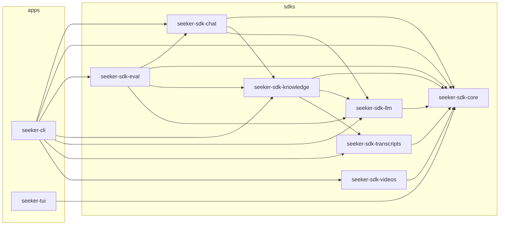

# Architecture

The repo is a **uv workspace**. Reusable code lives in SDKs (libraries), thin front ends in apps, and
deployables (later) in services. One `uv.lock`, one `uv sync --all-packages`.

```
pyproject.toml            workspace root (members: sdks/*, apps/*, services/*)
sdks/
  core/        seeker-sdk-core         MasterList store, errors, settings, plugin registry (no dependencies)
  videos/      seeker-sdk-videos       video sources (plugins), method resolution, update/rebuild, catalog
  transcripts/ seeker-sdk-transcripts  transcript methods (plugins), formats + conversion, compare
  llm/         seeker-sdk-llm          language-model tools, providers (file queue now, Gemini later), cache, budget
  knowledge/   seeker-sdk-knowledge    processing strategies: transcripts -> passages (text files under data/knowledge)
  chat/        seeker-sdk-chat         chat strategies: find passages (multi-script BM25), a model answers with citations
  eval/        seeker-sdk-eval         eval/questions against (processing, chat) pairs: scores, judge, comparison
apps/
  cli/         seeker-cli              the `seeker` command (argparse, logging, prompts, exit codes)
  tui/         seeker-tui              the Textual menu (builds and runs `mise run ...` commands)
services/                              (empty for now) deployables built on the SDKs
scripts/                               ops shell scripts: docker, nuke, build, api key, ...
data/  logs/  docs/                    data and documentation (unchanged locations)
```

## Rules
- Dependencies point one way: apps and services depend on SDKs, SDKs depend on `seeker-sdk-core`, and
  `core` depends on nothing. An SDK never imports an app.
- SDKs are libraries: no logging setup, no `sys.exit`, no prompts, nothing that reads the working
  directory at import time. They raise `seeker_sdk_core` errors; apps decide how to report them.
- Behaviour that matters is tested in the package that owns it (`sdks/*/tests`, `apps/*/tests`);
  `mise run test` runs everything.
- Front ends stay in sync: `scripts/tests/test_tui_cli_parity.py` checks that every CLI command and option
  and every mise task can be reached from the TUI, or is listed as an exception with a reason.
- The data format and file locations (`data/videos_master.json`, `.backup`, `logs/*.log`) are part of
  the contract; the daily workflow depends on the log lines `🆕 New:` and `Successfully added`.

## Plugins
Plugins are discovered through Python **entry points**; no registry file, no edits to existing code.

| Group | Interface | Shipped plugins | Chosen by |
|---|---|---|---|
| `seeker.video_sources` | `seeker_sdk_videos.VideoSource` | `youtube_api`, `ytdlp` | `MASTER_LIST_METHOD` |
| `seeker.transcript_methods` | `seeker_sdk_transcripts.TranscriptMethod` | `ytdlp`, `youtube_transcript_api` | `--method` / `TRANSCRIPT_METHOD` |
| `seeker.llm_providers` | `seeker_sdk_llm.Provider` | `queue` (Gemini later) | `--provider` / `SEEKER_LLM_PROVIDER` |
| `seeker.processing_strategies` | `seeker_sdk_knowledge.ProcessingStrategy` | `chunks`, `english-notes` | `seeker knowledge process --strategy` |
| `seeker.chat_strategies` | `seeker_sdk_chat.ChatStrategy` | `keyword`, `multilingual` | `seeker ask/eval --chat` |

`seeker plugins` lists what is installed. A plugin in another package declares itself in its own
`pyproject.toml`:

```toml
[project.entry-points."seeker.video_sources"]
my_source = "my_package.sources:MySource"
```

Explicit means explicit: a chosen method is the only one used, a failure is an error, and there is no
fallback to another plugin. In-process registration (`seeker_sdk_core.plugins.register`) exists for
tests and notebooks.

## Language-model tools, strategies and evaluation
Everything that needs a language model is a **tool** (`seeker_sdk_llm.Tool`): instructions kept as a versioned
prompt file next to the code (`prompts/<name>_<version>.md`), a JSON input, and the JSON shape the answer must
have. A **provider** runs tools; the code that uses a tool never knows which one:

| Tool | Used by | Input -> output |
|---|---|---|
| `english_notes@v1` | processing `english-notes` | a 15-minute transcript window -> attributed English notes with times, refs, topics |
| `expand_query@v1` | chat `multilingual` | a question -> keyword queries in English, Roman Urdu, Devanagari, Bengali |
| `answer@v1` | every chat strategy | question + passages -> answer, cited passage ids, not_found |
| `judge@v1` | evaluation | question + reference + answer -> correct, partial, wrong or declined |

- **`queue` provider (now):** each request becomes `data/llm/queue/pending/<id>.json` (instructions, input,
  schema and where to answer). A worker writes `data/llm/queue/done/<id>.json`. During development the workers are
  disposable fast subagents (Claude Haiku) standing in for Gemini Flash; a person or a script can answer too.
  The next run checks the answer against the schema (a bad one goes to `rejected/` and the request stays),
  caches it and continues. Commands that are waiting exit with code 75; running them again continues.
- **Cache:** `data/llm/cache/<tool>@<version>/<id>.json`. A request id is a hash of tool, instructions and input,
  so an answer is never paid for twice and an edited prompt never reuses old answers.
- **Budget:** `--max-requests` caps new requests per run (for a provider with a daily quota).
- **Gemini (later):** one more provider in `seeker.llm_providers` that sends the same instructions, input and
  schema; nothing else changes.

Processing strategies write `data/knowledge/<strategy>@<version>/` (passages per video as JSONL, readable
notes, a manifest). Chat strategies search those passages. `seeker eval run --processing X --chat Y --videos ...`
answers `eval/questions` with that pair and scores it: retrieval (right video and time among the passages),
keywords (`must_mention`), the judge's verdict and "not found" on unanswerable questions. `seeker eval compare`
puts the latest run of every pair side by side. A new strategy or a new prompt version is just another row.

## Adding an SDK
```bash
mise run sdk:new -- rag                          # sdks/rag -> seeker-sdk-rag (import seeker_sdk_rag)
mise run sdk:new -- bing --plugin video_sources  # plus a plugin skeleton and its entry point
uv sync --all-packages && mise run test && mise run build:sdks
```
Conventions: directory `sdks/<name>`, distribution `seeker-sdk-<name>`, import `seeker_sdk_<name>`,
`src/` layout, `uv_build` backend, a README with a usage example, tests next to the code.

## Building packages
`mise run build:sdks` builds every SDK as its own wheel into `dist/sdks`
(`seeker_sdk_core-0.1.0-py3-none-any.whl`, ... every wheel starts with `seeker`) and then installs
the wheels, not the workspace, into throwaway venvs to prove that `seeker-sdk-core` has no
dependencies, that each SDK installs and imports on its own, and that plugins are discovered.
`mise run build:apps` does the same for `seeker-cli` and `seeker-tui` (`dist/apps`).
All packages share version 0.1.0 for now; bump it in the package's `pyproject.toml`.

## Seeing it: the Tilt dashboard
`mise run local:tilt:up` opens a Tilt dashboard (http://localhost:10350) that shows the workspace live.
The `Tiltfile` asks `scripts/workspace_graph.py` for the packages, so it follows the pyprojects:


(Regenerate with `mise run local:workspace:graph -- --mermaid`.)

- One resource per package, grouped by `sdks` / `apps` / `services`. It runs the package's tests, waits
  for the packages it depends on (`resource_deps`), and re-runs when its own code or the code of any
  package it depends on changes. Touch `sdks/core` and core, videos, transcripts and cli all re-run;
  `seeker-tui` does not, because it does not depend on core.
- `registry`: the text graph and the plugins found through entry points (`seeker plugins`).
- `data`: `videos-report`, `transcripts-stats` and `transcripts-missing` (which videos still lack a transcript, and which
  wait for a retry), refreshed when `data/videos_master.json` changes.
- `methods`: which method local, act and gh use (`mise run all:method:show`). It refreshes by itself when `fnox.local.toml`
  or `.vars` changes and has a "Set a method (local or act)" button. Changing the gh variable is not a button.
- Manual buttons (press the trigger arrow): `videos-update`, `videos-rebuild`, `transcripts-download` (5 transcripts, or
  `tilt up -- --limit N`), `transcripts-compare` (newest video, or `tilt up -- --video ID`), `build-wheels` (blocked until all tests are green),
  `act-videos-update`, `docker-diagnose`, `gh-runs`. Nothing in the dashboard publishes to GitHub.
- `mise run local:tilt:ci` runs the automatic resources once without the UI (exit code 0 = all green).
A new SDK from `mise run sdk:new` shows up in the dashboard by itself.

## Where future work fits (not planned yet)
- **Daily update through an API / service**: `services/daily-update` (a deployable job or HTTP API) that
  calls `seeker-sdk-videos` and `seeker-sdk-core`; the GitHub workflow can then call it instead of
  carrying the glue in YAML.
- **UI SDK** (for example Chainlit): `sdks/ui` -> `seeker-sdk-ui`, depending on the other SDKs.
- **Generative AI / RAG / graph SDKs**: `sdks/rag`, `sdks/graph`, ... reading the master list and the
  transcripts (`data/transcripts`, linked from the list) through `seeker-sdk-core`.
Each is a new package scaffolded with `mise run sdk:new`; none of the existing packages has to change.
